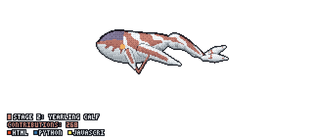

<div align="center">
[](https://ishekaa12.github.io)
 
<a href="https://github.com/PramudithaN/git-tulkun">
  
</a>
</div>
---
 
```console
isheka@umit:~$ whoami
isheka singh · CSE undergrad, sem 3 · UMIT, SNDT Women's University, Mumbai
 
isheka@umit:~$ cat focus.txt
backend engineering (Java first) · DSA · ML pipelines
curious about: how things actually work under the hood
 
isheka@umit:~$ cat now.txt
- DSA in Java, LeetCode, 50+ problems down, trees & graphs next
- Flask, the slow way (Corey Schafer series)
- rebuilding my old projects from scratch so I can explain every line
- Obsidian vault for everything I learn
 
isheka@umit:~$ echo $MOTTO
better than I was yesterday, not the best today
```
 
---
 
## 🧰 Toolbox
 
[](https://skillicons.dev)
 
[](https://skillicons.dev)
 
| Level | What |
|---|---|
| 🟢 Daily driver | Java · Python · Git/GitHub |
| 🟡 Comfortable | C · JavaScript · HTML/CSS · Flask |
| 🔵 Used on projects, still learning | Pandas · NumPy · Scikit-learn · XGBoost · Plotly · FastAPI · Spring Boot |
 
---
 
## 🚀 Projects
 
```console
isheka@umit:~/projects$ ls
florapulse  predictive-maintenance  alt-text-pr-bot  tutte-embedding  dungeon-escape  movie-recommender  analytics-dashboard
```
 
| Project | What it does | Built with |
|---|---|---|
| **🌿 FloraPulse** | IoT plant care that predicts *when* a plant will need water from its soil-moisture depletion rate, instead of just reacting to a threshold. | `ESP32` `FastAPI` `SQLite` `Streamlit` |
| **🏭 Predictive Maintenance** | Predicts equipment failure from sensor data across machine types. Model training → Flask API → live dashboard on Render. Trained on NASA turbofan and AI4I datasets. | `Python` `XGBoost` `Scikit-learn` `Flask` `Plotly` |
| **♿ Alt-Text PR Bot** | Reads the images in a repo's README, has Gemma 4 classify them and write alt text, shows a before/after diff, then opens a PR through the GitHub API. Hacktoberfest hackathon project. | `Gemma 4` `GitHub API` `DigitalOcean` |
| **🧵 Tutte Embedding** | Flattens a 3D mesh into 2D with spring-based graph embedding (UV unwrapping). A 7-day self-directed project to understand the math, not just call a library. | `Python` `Graph theory` |
| **🗡️ Dungeon Escape** | Dungeon game written in C, built around pointers and linked lists. | `C` |
| **🎬 Movie Recommender** | Content-based recommender using TF-IDF, with SVD and KNN for finding similar movies. | `Python` `Scikit-learn` |
| **📊 Analytics Dashboard** | Privacy-first analytics dashboard, built at the NMIMS ACM Hackathon. | `FastAPI` `SQLAlchemy` `Chart.js` |
 
<sub>Also: [CodeCards](https://github.com/ishekaa12/CodeCards) (Chrome extension + [dashboard](https://codecard-dashboard.vercel.app)) · [College Resource Hub](https://github.com/ishekaa12/college-resource-hubb) · [Rhythm Routes](https://github.com/ishekaa12/rhythm-routes-website)</sub>
 
---
 
## 🌱 Beyond the Code
 
- 🧑‍🏫 Led the **Git & GitHub** and **CSS** sessions at *Code Ignite*, a beginner workshop series by ACM-W SNDT UMIT
- 🤝 Class Representative for my CSE cohort
- 🔓 Open source: first PR in March 2026; contributor in Girls Who Yap Fellowship 2.0 and Elite Summer Coder 2026
---
 
## 📊 GitHub Stats
 
<div align="center">
<picture>
  <source media="(prefers-color-scheme: dark)" srcset="https://github-readme-stats.vercel.app/api?username=ishekaa12&show_icons=true&hide_border=true&theme=tokyonight" />
  
</picture>
<picture>
  <source media="(prefers-color-scheme: dark)" srcset="https://github-readme-stats.vercel.app/api/top-langs/?username=ishekaa12&layout=compact&hide_border=true&theme=tokyonight" />
  
</picture>
</div>
---
 
## ✍️ Latest from the Blog
 
<!-- BLOG-POST-LIST:START -->
<!-- BLOG-POST-LIST:END -->
 
📖 More at **[ishekaa12.github.io](https://ishekaa12.github.io)**
 
---
 
## 📬 Let's Connect
 
[](https://www.linkedin.com/in/isheka-singh-152264309)
[](mailto:ishekasingh26@gmail.com)
[](https://ishekaa12.github.io)
 
<sub>Still learning, still building. If you're learning too, say hi. 🌱</sub>
 
